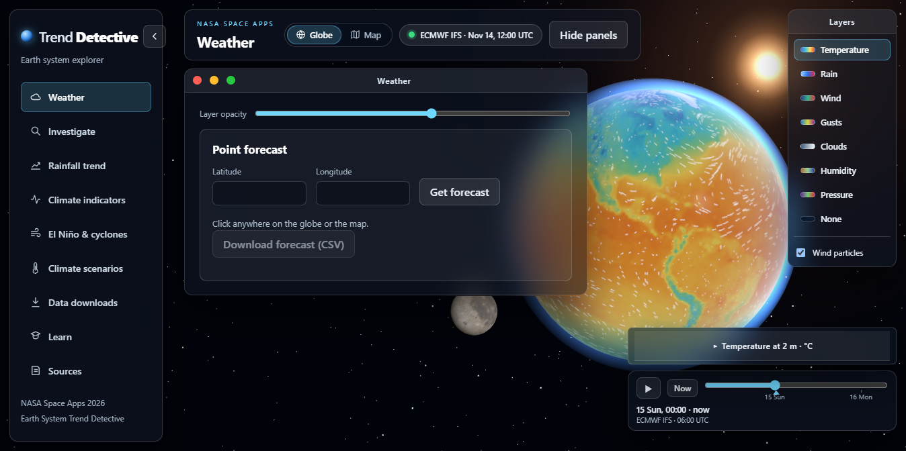
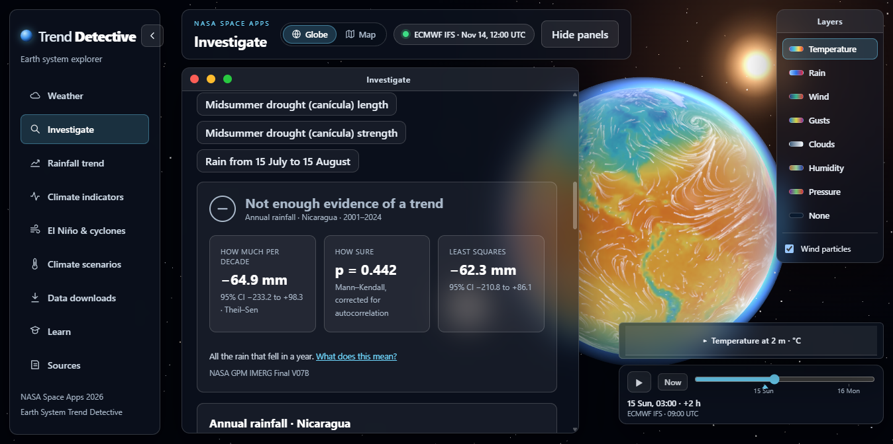
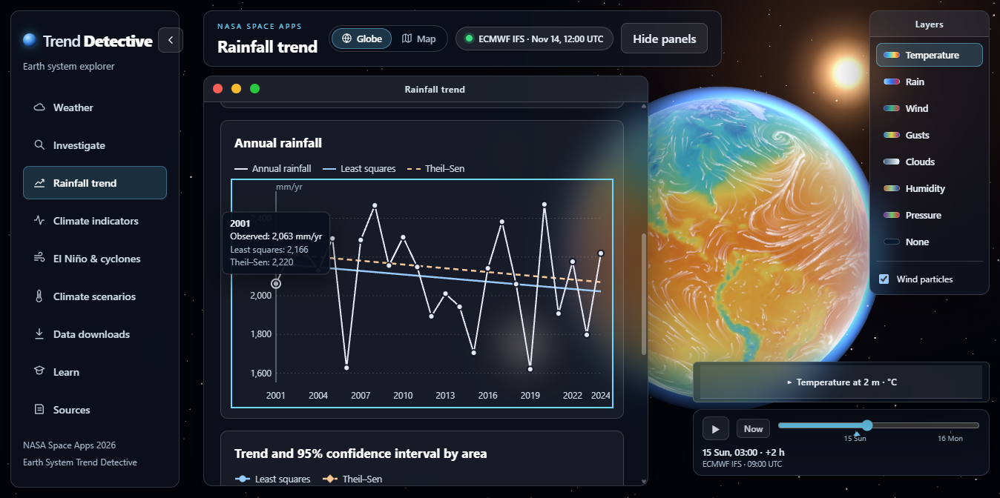
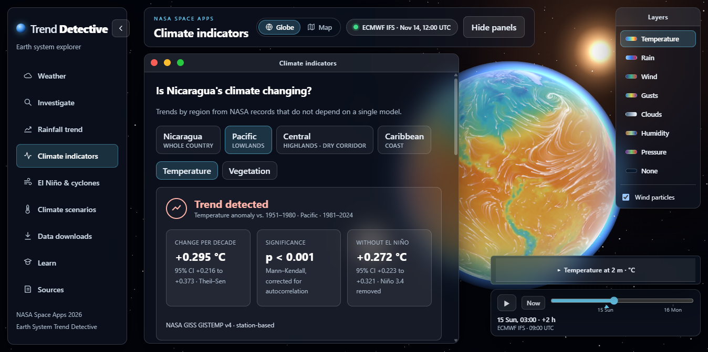
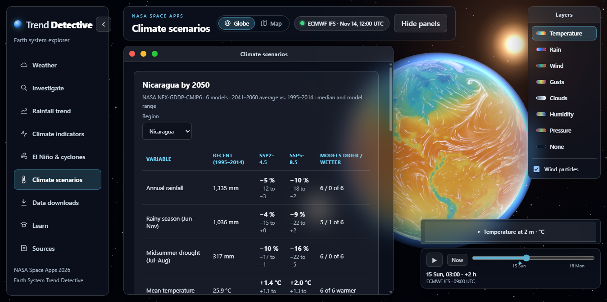
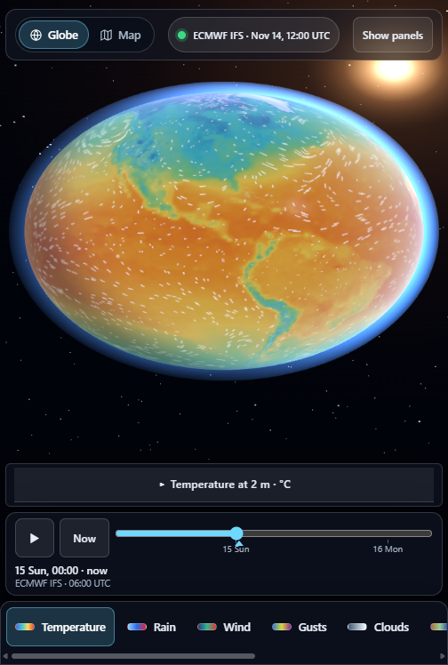
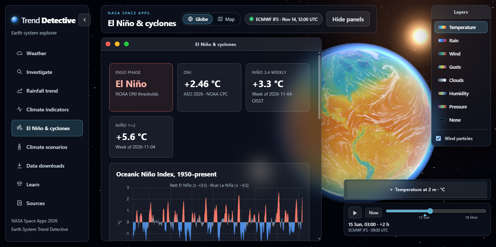
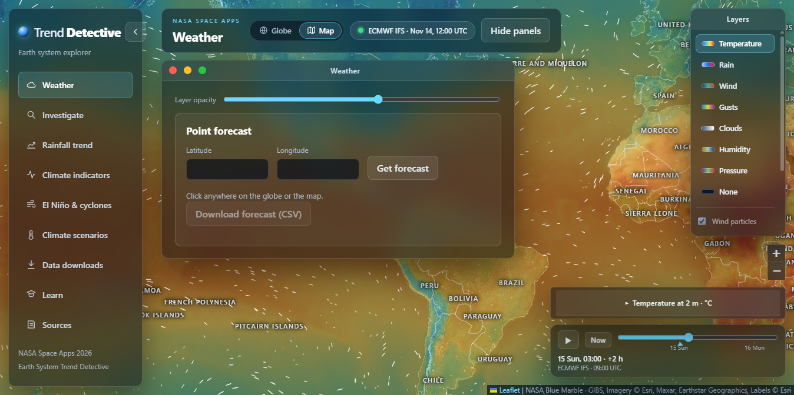

# Auditoría de accesibilidad (WCAG 2.2 AA) — Trend Detective

## 1. Alcance y metodología

Se realizó una auditoría de accesibilidad sobre la compilación estática publicada de la aplicación web en su estado previo a correcciones, conforme a los criterios de las Pautas de Accesibilidad para el Contenido Web (WCAG) 2.2 nivel A y AA.

Las comprobaciones se ejecutaron en Chromium mediante Chrome DevTools Protocol (CDP) en escritorio (`1366 × 768`) y móvil (`390 × 844`), abarcando:

1. **Operación exclusiva por teclado**: recorridos con `Tab`, `Shift+Tab`, `Enter`, `Espacio`, `Escape` y teclas de dirección sobre globo 3D, mapa 2D Leaflet, barra lateral de navegación, paneles de pestañas, filtros de radio, recorridos guiados, línea temporal y alertas.
2. **Árbol de accesibilidad (AXTree) y lector de pantalla**: inspección con `Accessibility.getFullAXTree` para verificar idioma declarado (`lang="en"`), puntos de referencia (*landmarks*), nombres accesibles, roles de gráficas `<canvas>`, semántica de tablas, valores en controles deslizantes y anuncios dinámicos (`aria-live`).
3. **Contraste de color y uso no exclusivo del color**: cálculo exacto de relación de contraste WCAG 2.2 sobre estilos computados reales, considerando la composición alfa de los paneles translúcidos (`.ventana`) frente a fondo espacial oscuro (`rgb(1, 3, 10)`) y globo iluminado (`rgb(225, 145, 65)`), así como el contraste de componentes de interfaz (bordes, ejes, cuadrículas y series gráficas).
4. **Movimiento reducido (`prefers-reduced-motion: reduce`)**: emulación de preferencia del sistema mediante CDP (`Emulation.setEmulatedMedia`) verificando transiciones CSS, animaciones WebGL/Canvas en tiempo de ejecución y animaciones de librerías gráficas.

---

## 2. Hallazgos identificados

| ID | Gravedad | Dónde (pestaña, elemento, dispositivo) | Qué pasa | Cómo reproducirlo | Propuesta |
| --- | --- | --- | --- | --- | --- |
| **B-01** | bloqueante | Vista 3D y Mapa (`#espacio`, `#mapa`, selector de vista; escritorio y móvil) | El lienzo del globo `#espacio` (`canvas[tabindex="0"]`) aplica `outline: none` en `app/estilos.css`, haciendo invisible el indicador de foco por teclado. Pese a su `aria-label`, no acepta `Enter` ni `Espacio` para consultar el pronóstico del punto centrado. Además, al cambiar a modo mapa (`modo-mapa`), `#espacio` permanece en el orden de tabulación detrás de `#mapa`. | 1. Pulsar `Tab` / `Shift+Tab` hasta situar el foco en `#espacio` (ver `accesibilidad-01.png`). No se distingue ningún anillo de foco. 2. Pulsar `Enter` o `Espacio` con el foco en `#espacio`: no se dispara la consulta meteorológica. 3. Activar «2D map» y recorrer con `Tab`: el foco pasa por `CANVAS#espacio` antes de alcanzar `DIV#mapa`. | Restituir indicador de foco visible (`outline: 2px solid var(--cian)`) para `#espacio:focus-visible` y `#mapa:focus-visible`; habilitar `Enter`/`Espacio` en `#espacio` para disparar `alElegir` sobre el centro actual; deshabilitar del orden de tabulación (`tabindex="-1"` y `aria-hidden="true"`) el elemento no activo entre `#espacio` y `#mapa`. |
| **B-02** | bloqueante | `Investigate` (`#inv-categorias`, `#inv-lugares`, `#inv-variables`, `#inv-demos`, `#inv-demo-panel`) y `Climate indicators` (`#ind-regiones`, `#ind-variables`); escritorio y móvil | Al pulsar `Enter` o `Espacio` en cualquier botón `role="radio"`, la función de renderizado llama a `replaceChildren()`, destruyendo el botón enfocado y devolviendo el foco a `document.body`. Ningún grupo `radiogroup` implementa `roving tabindex` (todos los botones tienen `tabindex="0"`, obligando a tabular `8`, `14` o `12` elementos por grupo). En los recorridos guiados (`#inv-demos`), abrir un ejemplo no mueve el foco al panel `#inv-demo-panel`, y pulsar `Enter` en `Finish` oculta el panel perdiendo el foco en `BODY`. | 1. Abrir `Investigate` o `Climate indicators`. 2. Enfocar con `Tab` una opción distinta a la activa en `#inv-lugares` o `#ind-regiones` y pulsar `Enter`: `document.activeElement` pasa a ser `BODY`. 3. Pulsar `Enter` en un botón de `#inv-demos` y avanzar hasta `Finish` con `Enter`: al cerrar `#inv-demo-panel`, el foco cae en `BODY`. | Implementar patrón `roving tabindex` (`tabindex="0"` solo en el radio activo y `-1` en el resto) en `botones()` de `app/investigar.js` y `app/indicadores.js`; restaurar el foco sobre el radio activo cuando el cambio se originó dentro del grupo; trasladar el foco al panel `#inv-demo-panel` al iniciar un recorrido y devolverlo al botón disparador al pulsar `Finish`. |
| **B-03** | bloqueante | Todas las gráficas `<canvas>` (`#graf-meteograma`, `#inv-serie`, `#inv-c-*`, `#ind-serie`, `#ind-contraste-graf`, `#graf-oni`, `#graf-nino34`, `#graf-dT`, `#graf-dP`, `#espacio`); escritorio y móvil | En `Accessibility.getFullAXTree`, ningún `<canvas>` aparece expuesto con rol gráfico ni resumen legible (`images: []`, `canvases: []`). Los lienzos `#graf-oni`, `#graf-nino34`, `#graf-dT` y `#graf-dP` carecen de `aria-label`, y todas las gráficas `<canvas>` carecen de `role="img"` y de descripción textual cuantitativa de los datos representados. | 1. Navegar por `Meteorology` (con pronóstico cargado), `Investigate`, `Climate indicators`, `Current phenomena` y `Climate scenarios` (`accesibilidad-02.png`, `04.png`, `05.png`, `07.png`). 2. Consultar `Accessibility.getFullAXTree` en CDP: no existen nodos `image` ni `canvas` con nombre ni datos para las gráficas. | Asignar `role="img"` a `#espacio` y a todos los `<canvas>` de gráficas (estáticos y generados dinámicamente); generar dinámicamente `aria-label` (o `aria-describedby`) descriptivo en inglés con rango temporal, valores extremos, mediana o tendencia observada en cada actualización de Chart.js y SVG, preservando los textos existentes probados en la interfaz. |
| **B-04** | alta | Globo 3D, partículas, gráficas Chart.js y desplazamientos (`app/espacio.js`, `app/campo.js`, `app/graficas-meteo.js`, `app/indicadores.js`, `app/investigar.js`, `app/estilos.css`); escritorio | Con `prefers-reduced-motion: reduce` activo por CDP, la escena WebGL continúa animando la Luna (`moverLuna`) y las `1800` partículas de viento (`pasoViento()`), produciendo diferencias de píxeles entre capturas en reposo; la transición entre globo y mapa (`aMapa`/`aGlobo`) conserva un *morph* de `300 ms`; `Chart.defaults.animation.duration` sigue en `300`; el desplazamiento en recorridos guiados usa `behavior: 'smooth'`; y no se escuchan cambios dinámicos de la preferencia del sistema. | 1. Emular `prefers-reduced-motion: reduce` mediante `Emulation.setEmulatedMedia`. 2. Ocultar los paneles (`soloMapa(true)`) y comparar dos capturas con `1,2 s` de intervalo: los píxeles cambian de forma continua. 3. Inspeccionar `Chart.defaults.animation.duration` (`300`) y observar la animación de cambio a mapa y de desplazamiento guiado. | Detener el bucle continuo cuando `prefers-reduced-motion: reduce` esté activo (mantener escena estática tras el dibujado inicial de viento y renderizar bajo demanda ante interacción o cambio de tamaño), eliminar el *morph* de `300 ms`, ajustar `Chart.defaults.animation.duration = 0`, reemplazar `scrollIntoView({ behavior: 'smooth' })` por `'auto'` y suscribirse al evento `change` de `matchMedia`. |
| **B-05** | alta | Paneles `.ventana`, textos secundarios, gráficas SVG/Chart.js y bordes de controles (`app/estilos.css`, `app/graficas-meteo.js`); escritorio y móvil | El fondo translúcido de `.ventana` (`rgba(18, 24, 38, .58)`) permite que el globo iluminado (`rgb(225, 145, 65)`) o el mapa claro reduzcan el contraste por debajo de los mínimos WCAG AA (`4,5:1` texto, `3:1` gráficos/UI): `--tenue` (`#a9b8c9`) baja a `3,44:1`, `--texto-3` (`#93a4b8`) a `2,73:1`, `.nota` (`#8fa1b5`) a `2,63:1`; series de gráficas `C.azul` (`#4f8fe8` → `2,13:1`), `C.rojo` (`#ff7b6b` → `2,75:1`), `C.violeta` (`#b493ff` → `2,83:1`) y barra neutra ONI (`rgba(157, 176, 198, .45)` → `2,62:1` incluso sobre fondo oscuro); cuadrículas (`rgba(255, 255, 255, .09)` → `1,30:1`) y bordes `--borde` (`rgba(255, 255, 255, .16)` → `1,57:1`) de inputs y selects fallan el `3:1` de componentes UI. | 1. Abrir `Investigate`, `Climate trends`, `Climate indicators`, `Climate scenarios` o `Current phenomena` sobre el globo iluminado (`accesibilidad-02.png`–`05.png`, `07.png`) o mapa (`accesibilidad-08.png`). 2. Evaluar los estilos computados compuestos frente a fondo oscuro y globo cálido con la fórmula de luminancia relativa WCAG 2.2. | Aumentar la opacidad de `.ventana` (y de los paneles de control en mapa) para garantizar contraste estable independientemente del fondo subyacente; elevar la luminancia de `--tenue`, `--texto-3`, `.nota`, `--borde` en controles interactivos, cuadrículas de Chart.js y colores de series (`C.azul`, neutral ONI) hasta cumplir `≥ 4,5:1` en texto y `≥ 3:1` en bordes y elementos gráficos. |
| **B-06** | alta | Línea temporal (`#lt-rango`, `#lt-etiqueta`), opacidad (`#opacidad-temp`), leyenda (`#leyenda-campo`) y escenarios (`#esc-tabla`, `#cambios`); escritorio y móvil | Los controles deslizantes `#lt-rango` y `#opacidad-temp` no actualizan `aria-valuetext` (un lector solo oye enteros como `0` o `60`). La tabla `#esc-tabla` carece de `<caption>`, `<thead>`, `<tbody>`, `scope="col"` y `scope="row"`. Las regiones dinámicas `#cambios` y `#esc-tabla` no anuncian actualizaciones con `aria-live="polite"`. El botón `.leyenda-alternar` expone literalmente los glifos `▸`/`▾` al árbol de accesibilidad. | 1. Inspeccionar `#lt-rango` y `#opacidad-temp` tras mover el control (`ArrowRight`): no existe `aria-valuetext`. 2. Navegar a `Climate scenarios` (`accesibilidad-05.png`) e inspeccionar `#esc-tabla` y `#cambios`: sin encabezados asociados ni `aria-live`. | Actualizar `aria-valuetext` en `app/campo.js` (fecha/hora legible) y `app/globo.js` (porcentaje); estructurar `#esc-tabla` en `app/indicadores.js` con `<caption>`, `<thead>`, `<tbody>` y atributos `scope`; añadir `aria-live="polite"` a `#cambios` y al contenedor de `#esc-tabla`; envolver `▸`/`▾` en ``. |
| **B-07** | alta | Estructura global (`index.html`, `<aside>`, `<main>`, `#mapa`, `app/estilos.css`); escritorio y móvil | No existe enlace para saltar al contenido principal (`WCAG 2.4.1`): desde el inicio de la página un usuario de teclado necesita recorrer `15` tabulaciones (barra lateral y conmutador de vista) antes de alcanzar los controles de la pestaña activa. `<aside>` carece de nombre accesible (`aria-label`). Además, el contenedor `#mapa` (`div[tabindex="0"]`) depende del contorno por defecto del navegador (`auto 1px`), poco visible frente al mapa claro. | 1. Recargar la aplicación y pulsar `Tab` repetidamente contando paradas hasta el primer control del panel activo. 2. Cambiar a `2D map` y enfocar `#mapa` (`accesibilidad-08.png`): el contorno por defecto es tenue. | Añadir un enlace de salto visualmente oculto hasta recibir foco (`<a href="#contenido-principal" class="saltar-contenido">Skip to main content</a>`) apuntando a `<main id="contenido-principal" tabindex="-1">`; añadir `aria-label="Navigation and tools"` a `<aside>`; definir regla explícita `:focus-visible` de `2px solid var(--cian)` sobre `#mapa` y contenedores interactivos. |
| **B-08** | alta | Banner de error (`#error`, `#error-cerrar`, `app/shell.js`); escritorio y móvil | Cuando aparece una alerta de error `#error`, pulsar `Escape` no la cierra (`errorEsc.hidden: false`), y al activarse el botón cerrar no se devuelve el foco al elemento previo si fue abierto desde un control de la interfaz. | 1. Provocar la visualización de `#error` (o mostrarlo desde `error()`) manteniendo el foco en `#consultar`. 2. Pulsar `Escape`: el mensaje `#error` permanece visible. | Añadir un manejador global de `Escape` cuando `#error` esté visible en `app/shell.js`, memorizando el elemento enfocado antes de mostrar `#error` (o cerrándolo desde teclado) para restaurar el foco al cerrarse. |
| **B-09** | media | Deslizadores `#opacidad-temp`, `#lt-rango` y botones de ventana `.punto`; escritorio y móvil | La altura efectiva de `#opacidad-temp` y `#lt-rango` medida en caja es de `18 px` (inferior al mínimo recomendado de `24 × 24 px` de WCAG 2.5.8 en sentido estricto del propio `<input>`, especialmente en móvil `accesibilidad-06.png`); la caja base de `.punto` mide `13 × 13 px` aunque su pseudoelemento `::before` amplía el área táctil a `25 × 25 px`. | 1. Medir `getBoundingClientRect()` en `#opacidad-temp`, `#lt-rango` y `.punto` en escritorio (`1366 × 768`) y móvil (`390 × 844`). | Ampliar el área táctil mínima (`min-height: 24px` / padding transparente o contenedor interactivo ≥ `24 × 24 px`) en los controles deslizantes y verificar su alineación en barra y pie. |
| **B-10** | media | `Climate trends` (`#comparacion svg`, `src/graficas.js`); escritorio | Las filas de comparación regional (`g[data-region]`) en `#comparacion` solo responden a clic de ratón/puntero (`focusableInside: 0`, sin `tabindex` ni manejadores `keydown`), impidiendo inspeccionar por teclado el detalle regional de cada fila (`accesibilidad-03.png`). | 1. Abrir `Climate trends` y recorrer `#comparacion` con `Tab`: el foco nunca entra en las filas `g[data-region]`. | Añadir `tabindex="0"`, `role="button"`, `aria-label` por región y activación por `Enter`/`Espacio` y flechas en `src/graficas.js` (fuera de los archivos permitidos en esta fase de corrección). |
| **B-11** | media | `Current phenomena` (`#graf-oni`, `app/graficas-meteo.js`); escritorio y móvil | Aunque los veredictos textuales de `.veredicto` y las tarjetas `#enos-tarjetas` acompañan los estados con texto e iconos (sin depender solo del color), en `#graf-oni` (`accesibilidad-07.png`) la clasificación de barras entre El Niño (`≥ +0,5 °C`), neutro y La Niña (`≤ −0,5 °C`) se distingue principalmente por color (rojo, gris translúcido, azul) sin líneas de umbral ni anotación en los propios ejes. | 1. Abrir `Current phenomena` y observar la gráfica ONI (`#graf-oni`) en escala de grises o sin referencia visual de umbral `±0,5 °C`. | Incorporar líneas horizontales de referencia en `+0,5 °C` y `−0,5 °C` etiquetadas en el gráfico ONI junto con su resumen textual accesible. |
| **B-12** | baja | `Learn`, `Sources`, `Current phenomena` (enlaces externos `target="_blank"`) y barra móvil `#menu-principal`; escritorio y móvil | Los enlaces externos con `target="_blank"` no advierten explícitamente que se abren en una nueva pestaña; en móvil (`accesibilidad-06.png`), el desvanecimiento lateral de las máscaras `.mas-izquierda` / `.mas-derecha` atenúa ligeramente el contraste de los botones de borde del menú horizontal. | 1. Inspeccionar los enlaces en `Learn`, `Sources` y el aviso de NHC en `Current phenomena`. 2. Observar `#menu-principal` en `390 × 844`. | Añadir texto accesible `(opens in new tab)` en los enlaces `target="_blank"` y ajustar el ancho/contraste de las máscaras de desplazamiento horizontal en móvil. |

---

## 3. Evidencia visual (estado inicial)

1. 
2. 
3. 
4. 
5. 
6. 
7. 
8. 
