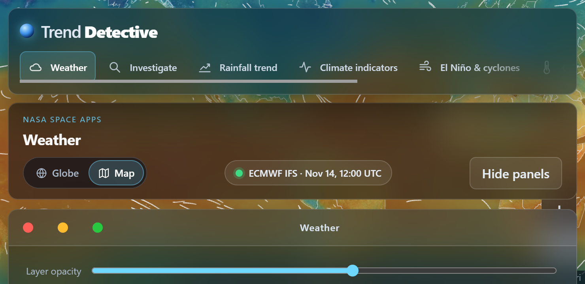
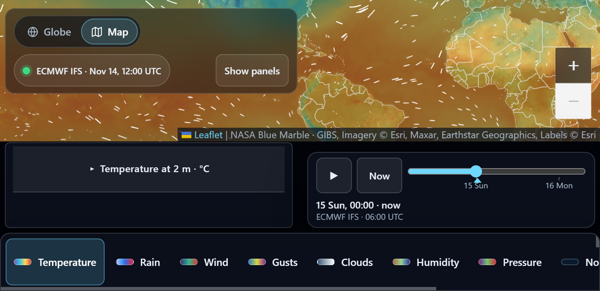
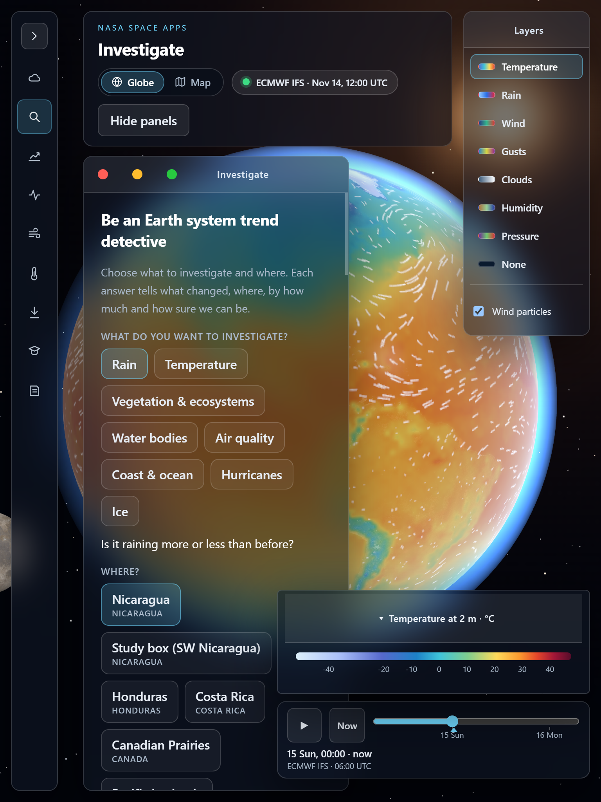
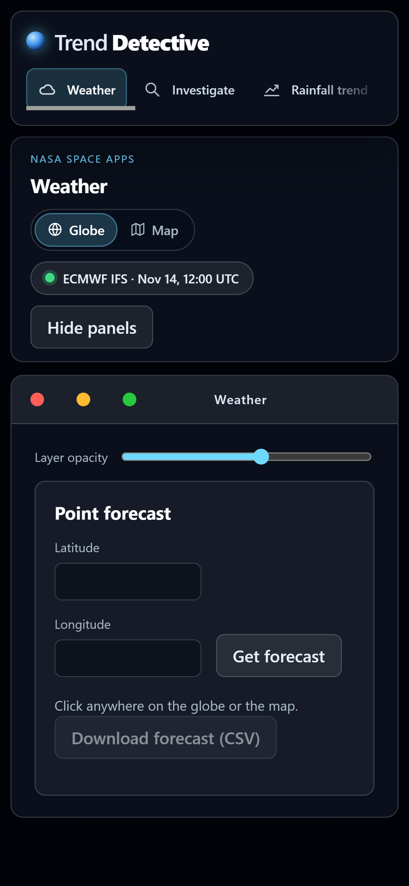
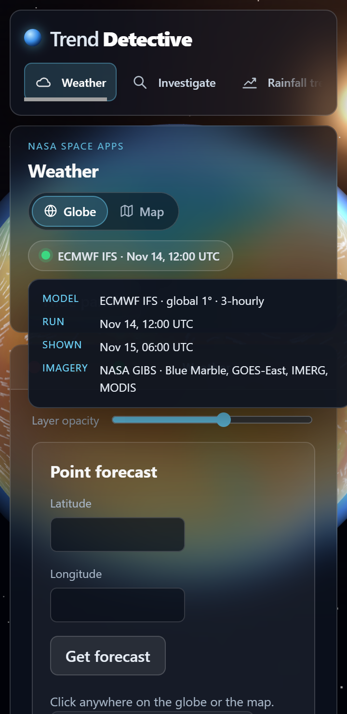
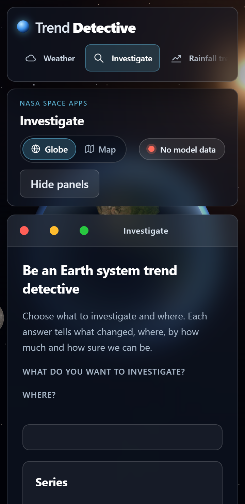
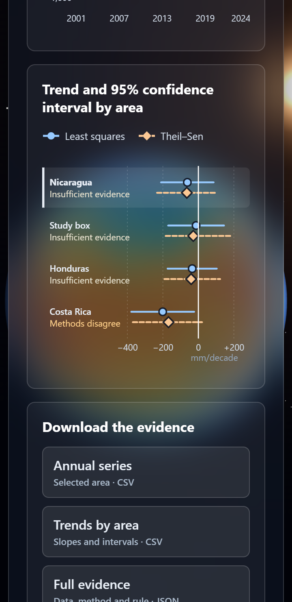
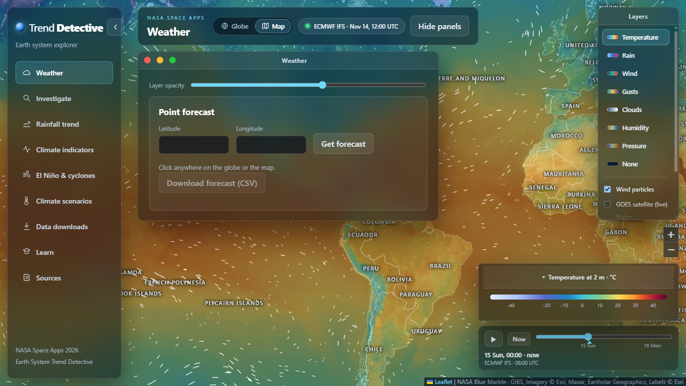

# Auditoría de diseño adaptable, móvil/tablet y rendimiento (`Agente C`)

**Alcance auditado:** compilación estática de `public/` (incluyendo `public/clima-base/`) servida por HTTP local en `http://127.0.0.1` en la rama `codex/audit-movil`, **antes de aplicar correcciones de código**.

---

## 1. Entorno, dispositivos emulados y metodología exacta de medición

- **Navegador y protocolo:** Google Chrome controlado por Chrome DevTools Protocol (CDP), sin redimensionar ventanas nativas de Windows sino mediante `Emulation.setDeviceMetricsOverride` (`mobile` + `deviceScaleFactor`) y `Emulation.setTouchEmulationEnabled` (`maxTouchPoints: 5` en perfiles táctiles).
- **Viewports probados (vertical y horizontal):**
  - Teléfono pequeño: `360×740` (`dpr: 2`, `mobile: true`, `hasTouch: true`) y `740×360`.
  - Teléfono estándar: `390×844` (`dpr: 3`, `mobile: true`, `hasTouch: true`) y `844×390`.
  - Tablet: `768×1024` (`dpr: 2`, `mobile: true`, `hasTouch: true`) y `1024×768`.
  - Escritorio / tablet alta en ambos sentidos: `768×1366` (`dpr: 1`, `mobile: true`, `hasTouch: true`) y `1366×768` (`dpr: 1`, `mobile: false`, `hasTouch: false`).
- **Herramientas de rendimiento:** No se encuentra instalada la CLI de `lighthouse` en el entorno (`where.exe lighthouse` sin resultados), por lo que **no se reportan puntuaciones sintéticas de Lighthouse**. En su lugar se midieron directamente en Chrome (`390×844`, caché deshabilitada vía `Network.setCacheDisabled`) las señales reales equivalentes de rendimiento, accesibilidad y buenas prácticas:
  - **Pintado y estabilidad visual (`PerformanceObserver`):** `first-paint`, `first-contentful-paint` (FCP), `largest-contentful-paint` (LCP) y `layout-shift` (CLS sin `hadRecentInput`).
  - **Bloqueo de hilo principal (TBT):** calculado doblemente tras FCP mediante `PerformanceObserver({ type: 'longtask' })` (`observerTbtMs`) y trazas CDP `Tracing.start`/`Tracing.end` filtrando eventos `RunTask` > `50 ms` en `CrRendererMain` (`traceTbtMs`).
  - **Red y métricas CDP:** `Network.requestWillBeSent` / `responseReceived` / `loadingFinished` (`encodedDataLength`) y `Performance.getMetrics`.
  - **Perfil `Slow 4G` + CPU restringida:** `Network.emulateNetworkConditions` (`latency: 400 ms`, `downloadThroughput: 188,744 B/s` ≈ 1.6 Mbps, `uploadThroughput: 86,400 B/s` ≈ 750 Kbps) + `Emulation.setCPUThrottlingRate({ rate: 4 })`.

---

## 2. Métricas base medidas (antes de correcciones)

### 2.1. Rendimiento en móvil (`390×844`)

| Métrica | Móvil `390×844` sin estrangulamiento | Móvil `390×844` · `Slow 4G` + `4x CPU` |
| --- | --- | --- |
| **TTFB** | `13 ms` | `429 ms` |
| **DOM Interactive** | `303 ms` | `2,599 ms` |
| **DOMContentLoaded** | `1,323 ms` | `6,063 ms` |
| **Load (`loadEventEnd`)** | `1,601 ms` | `18,312 ms` |
| **FP / FCP** | `1,040 ms` / `1,040 ms` | `2,400 ms` / `2,400 ms` |
| **LCP final (y elemento)** | `1,040 ms` (`P.pista`) | `21,120 ms` (párrafo `#investigar P`, tras FCP inicial a `2,772 ms`) |
| **CLS total** | `0` (capturado tras cargas ya en vuelo; en navegación lenta aflora el salto completo) | **`0.3786`** (`0.1757` a `4,114.8 ms` en `SECTION#meteorologia` + `0.2029` a `35,797.7 ms` en `#investigar ARTICLE`/`H3`) |
| **TBT (`PerformanceObserver` > FCP)** | `1,336 ms` (6 tareas >50 ms; máx. `855 ms`) | **`3,325 ms`** (13 tareas >50 ms; máx. `738 ms`) |
| **TBT (`Tracing` `RunTask` > 50 ms)** | `1,530.9 ms` (7 tareas; máx. `855.9 ms`) | **`3,544.6 ms`** (15 tareas; máx. `738.0 ms`) |
| **Carga diferida de `Investigate`** | `155 ms` tras clic | Fetch de `recursos_integrados.json`: **`11.13 s`** (`33,372.17 s` → `33,383.30 s`) |
| **Transferencia acumulada (46 req.)** | `5,526,140 B` (`5.27 MiB`) | `5,526,208 B` (`5.27 MiB`) |

### 2.2. Peso exacto de `data/recursos_integrados.json` y mayores activos en red

- **`data/recursos_integrados.json` (y `public/data/recursos_integrados.json`):**
  - **En disco:** **`609,492 bytes`** (`595.21 KiB`, `609.49 KB`).
  - **Transferido por HTTP (servidor estático local sin gzip/brotli, `status 200`):** **`609,764 bytes`** (`595.47 KiB`).
- **Principales activos descargados en la carga inicial + apertura de `Investigate`:**
  1. `assets/mundo.geojson`: `1,777,376 B` en disco / **`1,777,814 B`** transferidos (descargado **ansiosamente** al iniciar aunque la aplicación arranca en vista Globo 3D y `#mapa` está oculto; tarda **`28.13 s`** en `Slow 4G`, `33,355.60 s` → `33,383.73 s`).
  2. `assets/texturas/tierra-dia.jpg`: **`697,098 B`** transferidos.
  3. `data/recursos_integrados.json`: **`609,764 B`** transferidos.
  4. `clima-base/global-viento-6.json`: **`574,151 B`** transferidos.
  5. `assets/texturas/luna.jpg`: **`458,166 B`** transferidos.
  6. `assets/texturas/tierra-noche.jpg`: **`378,236 B`** transferidos.
  7. `clima-base/global-temperatura_c-6.json`: **`298,565 B`** transferidos.
  8. `three.module.min.js` (CDN): **`135,704 B`** (`135,314 B` payload).
  9. `chart.umd.min.js` (CDN): **`60,723 B`** (bloqueante en HTML).
  10. `leaflet.js` (CDN): **`42,718 B`** (bloqueante en HTML).

### 2.3. Comprobación en red lenta (`Slow 4G`)

- **A los `2,753 ms` (toma `slow4g-800ms`):** `<body class="modo-globo cargando">`, scripts locales aún bloqueados esperando dependencias previas, fondo `#01030a` negro liso.
- **A los `3,049 ms` (toma `slow4g-2200ms`):** `Chart` y `Leaflet` acaban de ejecutarse, cabecera muestra `"Loading data..."` y timeline `"Loading forecast..."`, fondo sigue completamente negro.
- **A los `5,300 ms` y `8,457 ms` (`movil-04.png`):** Ya llegaron `clima.json` y el pronóstico (`"ECMWF IFS · Nov 14, 12:00 UTC"`), pero `#espacio` sigue en `opacity: 0` esperando Three.js y las texturas mientras `mundo.geojson` (1.78 MB) satura la conexión. Durante **más de 8.5 segundos**, el fondo detrás de los paneles es negro sólido sin ningún spinner ni mensaje que indique que el globo 3D se está cargando. Tampoco hay indicador de carga al abrir `Investigate` mientras llega `recursos_integrados.json` (`11.13 s`).

### 2.4. Accesibilidad y Buenas Prácticas móviles

- **Aspectos correctos:** `<html lang="en">`, `<meta name="viewport" content="width=device-width,initial-scale=1">` sin bloqueo de zoom (`user-scalable=no`), `0` inputs/selects visibles sin etiqueta ni `aria-label`, `0` botones visibles sin texto o `aria-label`, `0` enlaces `target="_blank"` sin `rel="noopener"`.
- **Brechas detectadas:** fallo generalizado en tamaño mínimo táctil de `44×44 px` (`C-03`), uso de `overflow: hidden` / paneles pequeños sin alivio adecuado en apaisado (`C-01`), algunos `<svg>` decorativos visibles sin `aria-hidden="true"` (`C-10`), ausencia de `<link rel="icon">` (404 `/favicon.ico`) y petición inicial 404 esperada a `/clima-base/campo_nicaragua.json` (`C-09`).

---

## 3. Tabla de hallazgos

| ID | Gravedad | Dónde (pestaña, elemento, dispositivo) | Qué pasa | Cómo reproducirlo | Propuesta |
| --- | --- | --- | --- | --- | --- |
| **C-01** | **bloqueante** | `Weather` / `Map 2D` / `Hide panels`: `aside`, `header`, `.vista`, `#controles-mapa`, `.leaflet-control-zoom` en móvil horizontal (`740×360` y `844×390`) | `aside` (`110 px`) + `header` (`123 px`) consumen `233 px` (con huecos ~`265 px`) de `360 px` totales, dejando apenas **`~95 px`** de alto útil para `.vista`; en `panel+mapa2d`, `.leaflet-control-zoom` queda recortado/solapado detrás de `header`/`nav` (`44×38 px` en `740×360`, `28×16 px` en `844×390`). En `body.solo-mapa`, `header` (`106 px`) + `#controles-mapa` (`184 px`) reducen el mapa visible a una franja de **`60–90 px`** (`movil-01.png`, `movil-02.png`). | Emular `740×360` o `844×390` (`mobile: true, hasTouch: true`), activar Map 2D y alternar `Hide panels`. | En `@media (max-height:500px) and (max-width:1000px)` (`app/estilos.css`): compactar `aside` + `header` (ocultar subtítulos/márgenes excesivos, barra única compacta), dar prioridad visual a `.vista` sin solapar controles de Leaflet y compactar `#controles-mapa` + cabecera en `solo-mapa` (ocultar por defecto la leyenda o colapsarla en fila única) para liberar ≥60% del mapa. |
| **C-02** | **bloqueante** | `Investigate`, `Sources`, `Map 2D`: `.vista.ventana` frente a `#leyenda-campo` y `#linea-tiempo` en tablet vertical (`768×1024` y `768×1366`) | `.vista.ventana` fuerza `min 340 px` (`left: 106` → `right: 446`), mientras `--col: 400 px` sitúa `#leyenda-campo` y `#linea-tiempo` en `left: 354` → `right: 754`, produciendo un **solapamiento horizontal de `92 px`** que tapa/cruza `#lt-play` con botones de lugar (`44×44 px` en `nordeste_brasil`) y enlaces de `#fuentes` (`36×40 px` en `768×1024`, `16×29 px` en `768×1366`) (`movil-03.png`). | Emular `768×1024` o `768×1366` y abrir `Investigate` o `Sources`. | En `@media (max-width: 960px) and (min-width: 701px)` (`app/estilos.css`): ajustar `--col` (p. ej. `min(300px, 40vw)`) y permitir que `.vista.ventana` se adapte sin mínimo rígido que invada la columna derecha (`width: min(600px, calc(100vw - var(--izq) - var(--col) - 44px))`), eliminando por completo el cruce. |
| **C-03** | **bloqueante** | Todas las pestañas y controles de mapa en los 7 viewports táctiles (`360×740`, `740×360`, `390×844`, `844×390`, `768×1024`, `1024×768`, `768×1366`) | Controles táctiles por debajo de `44×44 px`: `nav button` (`40 px` en móvil), `#plegar-menu` (`34×34 px` en tablet), `#vista-globo`/`#vista-mapa` (`28–32 px`), `#indicador-datos` (`32 px`), `#solomapa` (`40–41 px`), `#barra-capas [data-var]` (`144×32 px` en tablet), `.botones-region button` (`39 px`), `.botones-variable button` (`35 px`), botones de acción (`41 px`), `button.mini` (`29.8 px`), `a.boton` (`37–41.4 px`), `button[data-descarga]` (`42.3 px`), `#lat`/`#lon` (`36 px`), `select` (`38 px`), sliders (`18 px` alto) y enlaces de acción/fuentes (`18–40.3 px`). | Inspeccionar `getBoundingClientRect()` (más pseudo-elemento `::before`) de elementos interactivos visibles bajo `pointer: coarse` en CDP. | En `@media (pointer: coarse)` y bloque móvil de `app/estilos.css`: garantizar `min-width: 44px; min-height: 44px` en botones, pestañas, `#plegar-menu`, `.interruptor button`, `.indicador`, `#solomapa`, `.capas-mapa [data-var]`, `.botones-region button`, `.botones-variable button`, `button.mini`, `a.boton`, `input`/`select`, sliders (`44 px` de altura táctil transparente sobre pista fina) y altura táctil suficiente en enlaces de lista/texto. |
| **C-04** | **alta** | Carga inicial y pestañas asíncronas (`#espacio`, `Investigate`, `Climate indicators`, `Climate scenarios`) en `Slow 4G` (`390×844`) | `<body class="modo-globo cargando">` carece de reglas CSS y nunca retira `.cargando` tras `espacio:listo`; `#espacio` permanece invisible (`opacity: 0`) durante `>8.46 s` sobre fondo negro `#01030a` sin spinner ni aviso (`movil-04.png`). Al abrir `Investigate` (`11.13 s` en Slow 4G) o `Indicators` mientras descarga su JSON, la ventana muestra contenedores vacíos sin indicador de carga. | Activar `Slow 4G` + `4x CPU` en `390×844`, recargar sin caché y observar entre `0 s` y `9 s`; luego pulsar `Investigate`. | Añadir indicador visual discreto centrado en el lienzo mientras `body.cargando` esté activo (`index.html`, `app/estilos.css`), retirar `.cargando` al evento `espacio:listo` (`app/shell.js`), y mostrar estado visual de carga (`indicador-carga`) mientras `#inv-veredicto`, `#ind-veredicto` o `#esc-tabla` estén vacíos antes de recibir sus datos. |
| **C-05** | **alta** | Rendimiento móvil y `Slow 4G`: `index.html`, `app/shell.js`, `assets/mundo.geojson` (`390×844`) | 1) Scripts externos (`leaflet.js`, `chart.umd.min.js`) y 16 locales bloqueantes en `index.html` (`DCL: 6,063 ms`, `Load: 18,312 ms`, `TBT: 3,325–3,544.6 ms` en Slow 4G). 2) `shell.js:82` llama a `iniciarMapa()` → `baseVectorial()` al iniciar en vista Globo 3D, descargando **`1,777,814 B`** de `assets/mundo.geojson` durante **`28.13 s`** en Slow 4G antes de que el usuario abra el mapa 2D. 3) **`CLS = 0.3786`**: `0.1757` en `SECTION#meteorologia` cuando `shell.js` añade `.ventana-barra` y `#indicador-texto` cambia el ancho envolviendo `<header>`, más `0.2029` al hidratarse `#investigar`. | Medir `PerformanceObserver`, `Tracing` y `Network` con `Slow 4G` + `4x CPU` en `390×844`. | 1) Añadir `preconnect` (`unpkg.com`, `cdn.jsdelivr.net`) y `defer` a los `<script>` clásicos en `index.html` conservando el orden exacto de dependencias. 2) Diferir `baseVectorial()` (`assets/mundo.geojson`) en `app/shell.js` hasta el primer cambio a vista Mapa 2D (`cambiarVista('mapa')` / `sicc:vista`). 3) Reducir el CLS (< `0.10`): estabilizar cabecera en primera pintura (anchura/disposición sin reflujo al cambiar `#indicador-texto`), evitar salto de bordes en `.vista` previa a JS y reservar `min-height` en bloques diferidos (`#inv-veredicto`, `#ind-veredicto`). |
| **C-06** | **alta** | `header > #indicador-detalle`, `#escenarios > #esc-tabla` y `solo-mapa` en móvil vertical (`360×740`, `390×844`) | Al abrir `#indicador-datos`, `#indicador-detalle` (`left: 0`, ancho `336 px`) desborda `<header>` (`scrollW: 354 > 338`) y `<main>` (`365 > 360` en `360×740`) recortándose contra el borde derecho (`movil-05.png`). Además, el doble padding horizontal (`.ventana-cuerpo` `22 px` + `article` `18 px`) reduce el ancho útil a `256 px`, comprimiendo `#esc-tabla` (`scrollW: 317 > 256`) y partiendo porcentajes en 3 líneas (`movil-06.png`); en `solo-mapa` (`360×740`), `#indicador-texto` se trunca a `"EC..."`. | Emular `360×740`, pulsar la píldora de estado o abrir `Climate scenarios`. | En `@media (max-width:700px)` (`app/estilos.css`): posicionar `#indicador-detalle` alineado con `fixed` o respecto a `<header>` dentro de `10 px..calc(100vw - 10px)` sin desborde; compactar padding horizontal de `.ventana-cuerpo` y `article` (`12 px` / `12 px`) para ganar `+32 px` útiles para tablas y gráficas; ajustar espaciado de `#esc-tabla` y en `solo-mapa` mejorar distribución para que la píldora no quede ilegible en `"EC..."`. |
| **C-07** | **media** | Escritorio (`1366×768`), `<aside> > .cabeza-menu > #plegar-menu` | Dentro de `--izq: 256 px` (`width: 228 px`), `.marca` (`21 px`) + `#plegar-menu` (`34×34 px`) provocan desborde interno en `<aside>` (`scrollW: 232 > clientW: 226`) y `#plegar-menu` sobresale `5 px` sobre el borde derecho (`r=247 > aside r=242`, `movil-08.png`). | Emular `1366×768` (`mobile: false`) e inspeccionar la esquina superior derecha de `<aside>`. | Ampliar `--izq` de `256 px` a `268 px` o ajustar `.marca { font-size: 19.5px }` y `gap: 6px` en `app/estilos.css` (propuesto). |
| **C-08** | **media** | `solo-mapa` (`360–844 px`) y `#barra-capas` en tablet apaisada (`1024×768`) | En `solo-mapa` móvil se renderiza barra horizontal visible en `.ventana-cuerpo` (`scrollW: 875–1009`) y en `#menu-principal` (`1115 px`). En `1024×768` mapa 2D (`pointer: coarse`), el alto disponible de `#barra-capas` (`clientH: 319 px` vs `scrollH: 642 px`) oculta todas las capas en vivo bajo scroll tras el degradado `.mas-abajo`. | Abrir `Map 2D` en `1024×768` o `Hide panels` en `360×740` / `740×360`. | Ocultar barra nativa con `scrollbar-width: thin`/discreto en tiras táctiles horizontales y ofrecer distribución compacta en 2 columnas o conmutador rápido de capas en vivo para `1024×768` (propuesto). |
| **C-09** | **media** | Red / Buenas prácticas: `data/recursos_integrados.json`, compresión HTTP, `/favicon.ico` y sondeo local | `data/recursos_integrados.json` pesa **`609,492 B`** en disco (`609,764 B` transferidos sin compresión; `11.13 s` en `Slow 4G`) porque agrupa las 8 categorías en un único archivo; además se emiten dos `404` evitables al arrancar (`/favicon.ico` y `/clima-base/campo_nicaragua.json`). | Inspeccionar pestaña Network sin caché en `390×844`. | Asegurar compresión Brotli/gzip en el servidor de producción, valorar particionar `recursos_integrados.json` por tema (fuera de alcance del Agente C para no alterar datos) y añadir `<link rel="icon">` SVG ligero para eliminar el 404 de favicon (propuesto). |
| **C-10** | **baja** | `Rainfall trend`: gráficas SVG (`#serie`, `#comparacion`) y `<svg>` decorativos visibles | La comprobación geométrica detecta desborde de `1–2 px` en `getBoundingClientRect()` de textos extremos (`"2024"`, `"mm/yr"`) y solapamiento mínimo de caja entre etiquetas de `#comparacion`, aunque visualmente (`movil-07.png`) todos los textos son nítidos y legibles. Asimismo, `<svg>` decorativos visibles generados dinámicamente carecen de `aria-hidden="true"`. | Abrir `Rainfall trend` en `360×740`–`1366×768` y revisar SVGs visibles sin `aria-hidden`. | Añadir `6–8 px` de margen interior al `viewBox` en `src/graficas.js` (fuera de archivos asignados al Agente C) y marcar `aria-hidden="true"` en `<svg>` decorativos de `veredicto` y capa vectorial (propuesto). |

---

## 4. Evidencias visuales previas a la corrección

### `movil-01.png` (`C-01`, `740×360` panel + mapa 2D)
`aside` + `header` consumen ~233 px de 360 px y tapan el botón `+` de Leaflet.

### `movil-02.png` (`C-01`, `740×360` tras pulsar «Hide panels»)
Incluso ocultando los paneles, cabecera y controles inferiores dejan apenas 60 px de alto para el mapa.

### `movil-03.png` (`C-02`, `768×1024` tablet vertical)
La ventana de `Investigate` (`right: 446 px`) invade `92 px` sobre `#leyenda-campo` y `#lt-play` (`left: 354 px`).

### `movil-04.png` (`C-04`, `390×844` en `Slow 4G` a los `8,457 ms`)
Fondo `#01030a` completamente negro sin indicador de carga del globo 3D mientras `mundo.geojson` (1.78 MB) y las texturas descargan.

### `movil-05.png` (`C-06`, `360×740` popover `#indicador-detalle`)
El detalle de procedencia meteorológica sobresale por la derecha respecto a `<header>` y al viewport.

### `movil-06.png` (`C-06`, `360×740` tabla `#esc-tabla` en `Climate scenarios`)
Doble padding reduce la tabla a `256 px` de ancho visible (`scrollW: 317`) y parte los porcentajes en múltiples líneas.

### `movil-07.png` (`C-10`, `360×740` gráfica SVG `#comparacion` en `Rainfall trend`)
Lectura visual legible a pesar de la proximidad geométrica entre las cajas de texto y el estrecho margen lateral.

### `movil-08.png` (`C-07`, `1366×768` escritorio)
El botón `#plegar-menu` (`<`) sobresale `5 px` sobre el borde derecho de `<aside>`.

